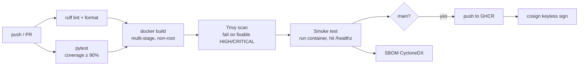

# cicd-pipeline-templates

[](https://github.com/Captainpeace6/cicd-pipeline-templates/actions/workflows/ci.yml)

One container delivery pipeline written three ways: **GitHub Actions**, **Jenkins** and **Azure DevOps**. Each version lints, tests, builds, scans, smoke-tests and pushes. The GitHub Actions version is a reusable workflow other repos can call, and it also signs images and publishes an SBOM.

The service being shipped is a small FastAPI inventory API in `app/`, with 100% test coverage.

## Pipeline



## Files

| File | What |
|---|---|
| `.github/workflows/ci.yml` | Caller: lint and test, then hands off to the reusable container workflow |
| `.github/workflows/_container.yml` | Reusable `workflow_call`: build → Trivy (gate + SARIF to the Security tab) → smoke test → SBOM → push → cosign sign |
| `jenkins/Jenkinsfile` | Declarative pipeline: lint and tests run in parallel inside `python:3.12-slim` agents, JUnit results, credentials-bound push only on `main`, cleanup in `post` |
| `azure-devops/azure-pipelines.yml` | Thin pipeline that only composes templates |
| `azure-devops/templates/*.yml` | Parameterized stage templates (`python-ci`, `container`) for many repos to share |
| `Dockerfile` | Multi-stage build; the runtime has no compilers and runs as UID 10001, with a `HEALTHCHECK` |

## Use the reusable workflow from another repo

```yaml
jobs:
  container:
    uses: Captainpeace6/cicd-pipeline-templates/.github/workflows/_container.yml@main
    permissions:
      contents: read
      packages: write
      id-token: write
      security-events: write
    with:
      image-name: my-org/my-service
      push: ${{ github.ref == 'refs/heads/main' }}
      health-path: /healthz
      port: 8080
```

## Verify a signed image

```bash
cosign verify ghcr.io/captainpeace6/inventory-api:latest \
  --certificate-identity-regexp 'https://github.com/Captainpeace6/cicd-pipeline-templates/.*' \
  --certificate-oidc-issuer https://token.actions.githubusercontent.com
```

## Design choices

- **Scan before push.** A vulnerable image never reaches the registry. `ignore-unfixed` keeps the gate on things you can act on, and the full report still goes to the Security tab.
- **Smoke test the real artifact.** Unit tests pass on source code; this proves the *image* starts and answers health checks.
- **No registry passwords in GitHub.** It pushes with the job's `GITHUB_TOKEN` and signs keyless through OIDC.
- **Same stages on all three systems,** so moving a team from Jenkins to Actions or Azure DevOps doesn't change what "passing" means.

## Run locally

```bash
pip install -r requirements-dev.txt
ruff check . && pytest
docker build -t inventory-api . && docker run -p 8000:8000 inventory-api
curl localhost:8000/healthz
```
